# QA Automation · Playwright

<div align="center">

Automatización de pruebas funcionales sobre DemoBlaze y Sauce Demo utilizando Playwright + TypeScript.

Universidad Mariano Gálvez de Guatemala<br>
Curso: Aseguramiento de la Calidad del Software<br>
Estudiante: Guillermo Jose Gomez Aguilera<br>
Carné: 1790-22-16429

</div>

<div align="center">

[](https://playwright.dev/)
[](https://www.typescriptlang.org/)
[](https://nodejs.org/)
[](#estado-de-los-laboratorios)
[](#reporte-de-defecto--dr-001)
[](https://github.com/)

</div>

---

## Sobre el proyecto

Este repositorio presenta el desarrollo de un conjunto de laboratorios de automatización de pruebas realizado durante el curso de Aseguramiento de la Calidad del Software. El proyecto se enfoca en la validación funcional de aplicaciones web (DemoBlaze y Sauce Demo) mediante herramientas modernas de testing automatizado.

A lo largo del trabajo se implementaron pruebas funcionales automatizadas y flujos end-to-end que cubren aspectos como navegación, validación de interfaces, selección de elementos, acciones de usuario, manejo de diálogos, el patrón Page Object Model (POM) y generación de evidencia profesional de pruebas (screenshots, videos y trazas).

Desde la Clase 07 el proyecto incorpora, además, la documentación formal de defectos siguiendo la cadena causal **Error → Defecto → Fallo**, y técnicas avanzadas de evidencia como `test.step()`, `testInfo.attach()` y comparación visual con `toHaveScreenshot()`.

---

## Estado de los laboratorios

La siguiente tabla resume el alcance de los laboratorios implementados y su estado final de ejecución.

| Laboratorio | Tema | Tests | Estado |
|---|---|---:|---|
| Clase 01 | Introducción a Playwright | 3 | ✅ Completado |
| Clase 02 | Navegación, esperas y capturas | 4 | ✅ Completado |
| Clase 03 | Locators en Playwright | 9 | ✅ Completado |
| Clase 04 | Actions y flujo funcional | 7 | ✅ Completado |
| Clase 06 | Page Object Model (POM) | 8 | ✅ Completado |
| Clase 07 | Roles QA + Error/Defecto/Fallo + Evidencias avanzadas | 7 | ✅ Completado |
| Clase 08 | Hooks (`beforeEach`/`afterEach`) y suites avanzadas | 7 | ✅ Completado |
| Clase 09 | Fixtures y tests parametrizados | 9 | ✅ Completado |
| **Total** | | **54** | **✅ Completado** |

> Los tests reto de `tests/tarea07.spec.ts`, `tests/tarea08.spec.ts` y `tests/tarea09.spec.ts` se documentan dentro de cada laboratorio y no se suman al total anterior.

---

## Navegación

- [Sobre el proyecto](#sobre-el-proyecto)
- [Tecnologías](#tecnologías-y-herramientas)
- [Laboratorio 01](#laboratorio-01--introducción-a-playwright)
- [Laboratorio 02](#laboratorio-02--navegación-esperas-y-capturas)
- [Laboratorio 03](#laboratorio-03--locators-en-playwright)
- [Laboratorio 04](#laboratorio-04--actions-y-flujo-funcional-en-playwright)
- [Laboratorio 06](#laboratorio-06--page-object-model-pom-en-sauce-demo)
- [Laboratorio 07](#laboratorio-07--roles-qa--error-defecto-y-fallo--evidencias-avanzadas)
- [Reporte de defecto DR-001](#reporte-de-defecto--dr-001)
- [Laboratorio 08](#laboratorio-08--hooks-y-suites-avanzadas)
- [Laboratorio 09](#laboratorio-09--fixtures-y-tests-parametrizados)
- [Evidencias](#evidencias-destacadas)
- [Estructura del proyecto](#estructura-del-proyecto)
- [Ejecución](#ejecución)
- [Documentación adicional](#documentación-adicional)

---

## Tecnologías y herramientas

El proyecto fue desarrollado con un conjunto de herramientas orientadas a la automatización de pruebas funcionales y a la documentación técnica del proceso.

| Tecnología | Uso |
|---|---|
| Playwright | Automatización de pruebas end-to-end |
| TypeScript | Desarrollo de los tests |
| Node.js | Entorno de ejecución |
| Chromium | Navegador utilizado para las pruebas |
| Playwright Trace Viewer | Depuración visual paso a paso (timeline, screenshots, red, consola) |
| ISO/IEC 25010 | Marco de referencia para atributos de calidad del software |
| Git | Control de versiones |
| GitHub | Repositorio y documentación |

---

## Laboratorio 01 · Introducción a Playwright

> Objetivo: validar la carga inicial de la aplicación y la visibilidad de los elementos principales del menú.

### Desarrollo del laboratorio

En este laboratorio se realizaron las primeras pruebas automatizadas sobre la interfaz de DemoBlaze, con el fin de verificar la carga correcta de la página principal y la disponibilidad de los elementos básicos de navegación.

### Pruebas implementadas

| # | Prueba | Estado |
|---|---|---|
| 1 | Página carga correctamente | ✅ |
| 2 | Menú de categorías visible | ✅ |
| 3 | Navbar contiene enlaces principales | ✅ |

### Ejecutar laboratorio

```bash
npx playwright test tests/clase01.spec.ts
```

### Evidencias

<details>
<summary><strong>📸 Test 1 · Página cargada correctamente</strong></summary>

<br>


</details>

<details>
<summary><strong>📸 Test 2 · Menú de categorías visible</strong></summary>

<br>


</details>

<details>
<summary><strong>📸 Test 3 · Navbar con enlaces principales</strong></summary>

<br>


</details>

<details>
<summary><strong>✅ Resultado general · 3 pruebas aprobadas</strong></summary>

<br>

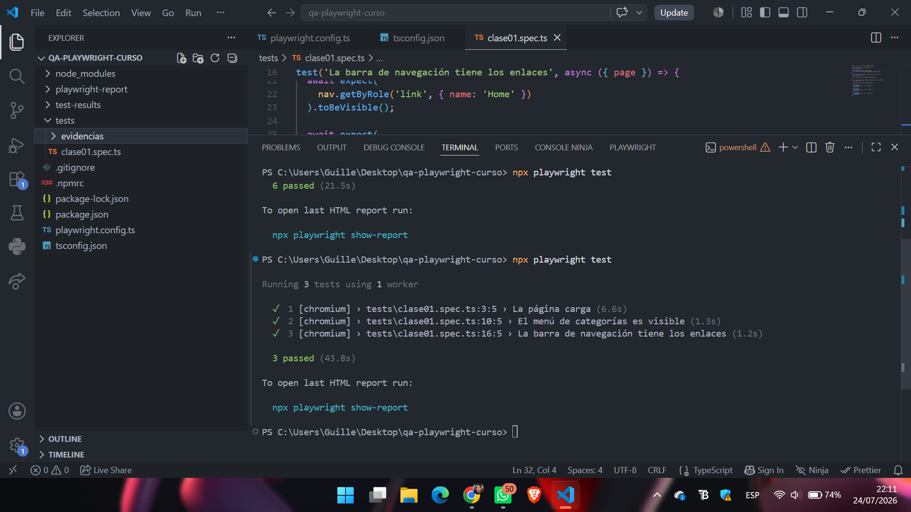

</details>

<details>
<summary><strong>📊 Reporte HTML de Playwright</strong></summary>

<br>

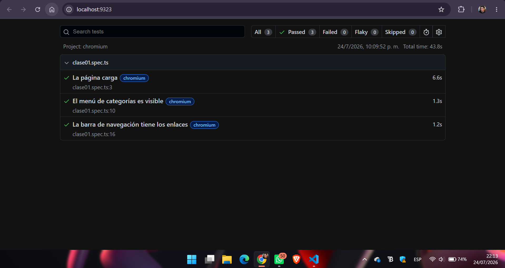

</details>

---

## Laboratorio 02 · Navegación, esperas y capturas

> Objetivo: comprobar la navegación entre páginas, la carga de contenido y la generación de capturas de evidencia.

### Desarrollo del laboratorio

Este laboratorio permitió validar la interacción del usuario con distintos elementos de la aplicación, incluyendo el recorrido hacia el carrito, la apertura del detalle de un producto y la captura visual de componentes clave de la interfaz.

### Pruebas implementadas

| # | Prueba | Estado |
|---|---|---|
| 1 | Navegar al carrito y regresar | ✅ |
| 2 | Abrir detalle de un producto | ✅ |
| 3 | Capturar navbar y footer | ✅ |
| 4 | Verificar tiempo de carga | ✅ |

### Ejecutar laboratorio

```bash
npx playwright test tests/clase02.spec.ts
```

### Evidencias

<details>
<summary><strong>📸 Test 1 · Navegar al carrito y regresar</strong></summary>

<br>

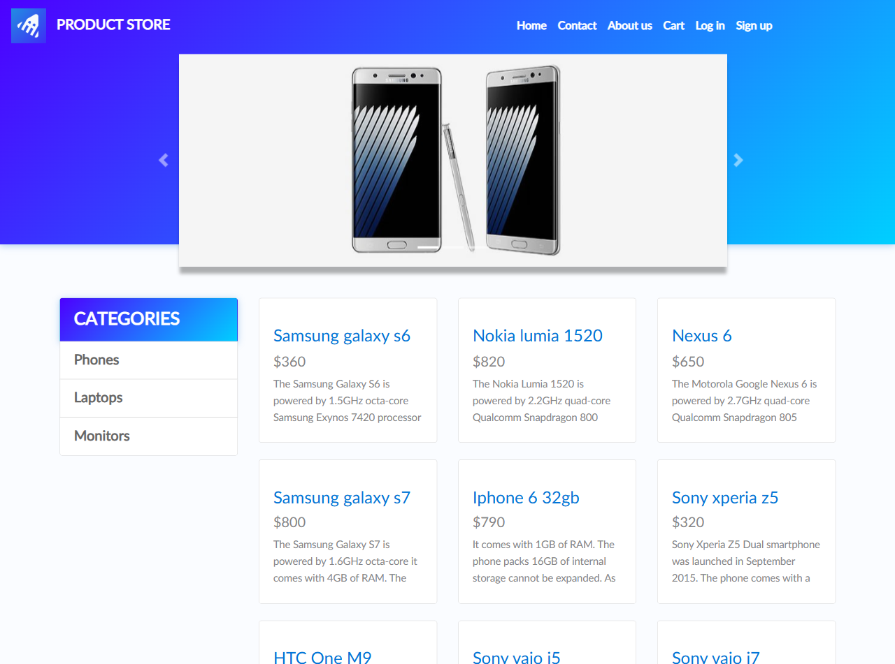


</details>

<details>
<summary><strong>📸 Test 2 · Abrir detalle de un producto</strong></summary>

<br>

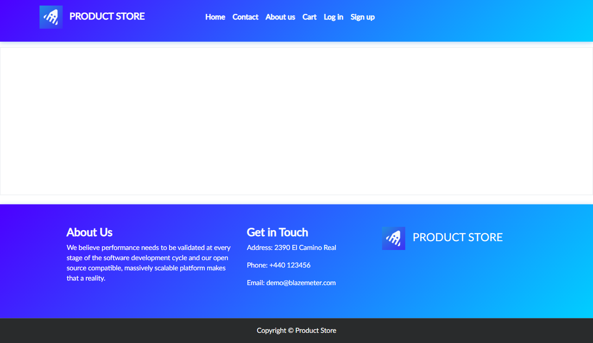

</details>

<details>
<summary><strong>📸 Test 3 · Navbar y footer</strong></summary>

<br>


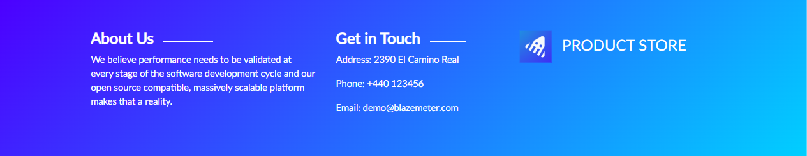

</details>

<details>
<summary><strong>📸 Test 4 · Tiempo de carga</strong></summary>

<br>


</details>

<details>
<summary><strong>✅ Resultado general · 4 pruebas aprobadas</strong></summary>

<br>

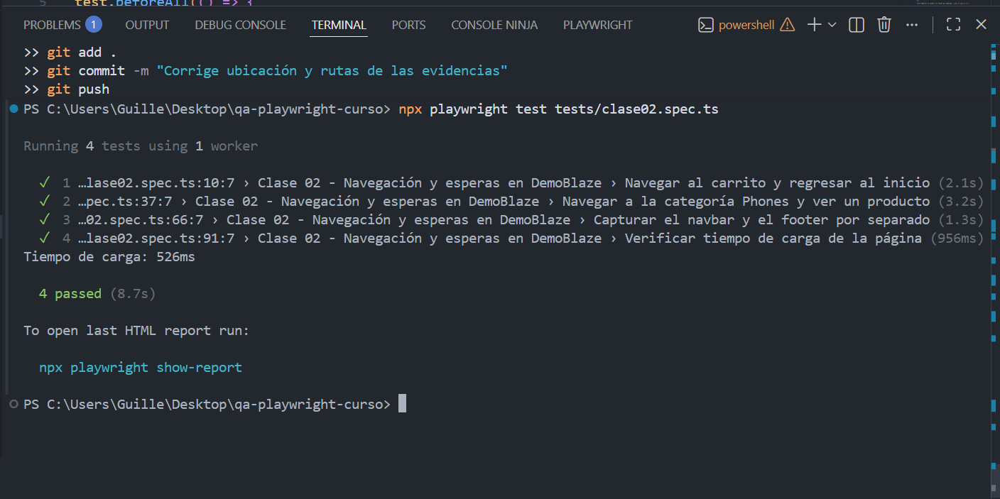

</details>

---

## Laboratorio 03 · Locators en Playwright

> Objetivo: practicar diferentes técnicas de localización de elementos en la interfaz de DemoBlaze.

### Desarrollo del laboratorio

En este laboratorio se exploraron distintos tipos de locators y estrategias de selección de elementos, con el propósito de fortalecer la precisión y estabilidad de las pruebas automatizadas.

### Pruebas implementadas

| # | Prueba | Estado |
|---|---|---|
| 1 | Locator por texto | ✅ |
| 2 | Locator por CSS | ✅ |
| 3 | Locator por ID | ✅ |
| 4 | Locator por atributo | ✅ |
| 5 | Locators encadenados | ✅ |
| 6 | Negación de elementos | ✅ |
| 7 | Reto 1: Place Order con getByRole | ✅ |
| 8 | Reto 2: producto con filter | ✅ |
| 9 | Reto 3: selector por atributo parcial | ✅ |

### Ejecutar laboratorio

```bash
npx playwright test tests/clase03.spec.ts
```

### Evidencias

<details>
<summary><strong>📸 Test 1 · Locator por texto</strong></summary>

<br>


</details>

<details>
<summary><strong>📸 Test 2 · Locator por CSS</strong></summary>

<br>

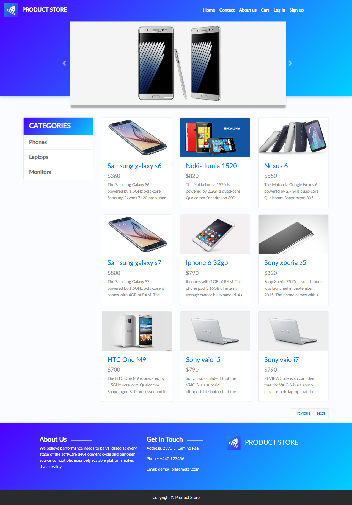

</details>

<details>
<summary><strong>📸 Test 3 · Locator por ID</strong></summary>

<br>

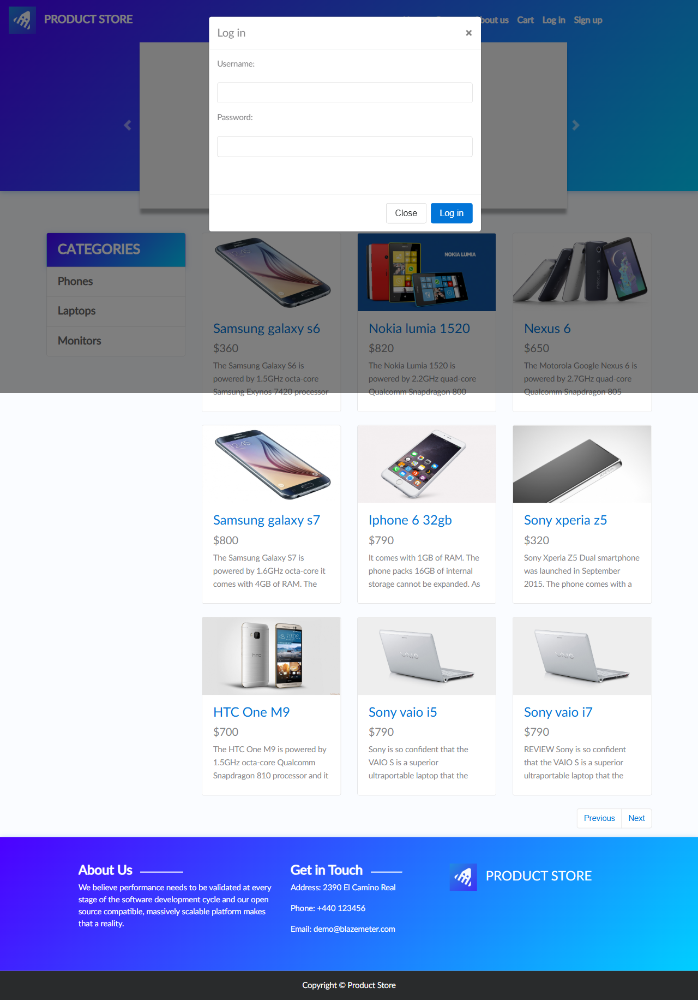

</details>

<details>
<summary><strong>📸 Test 4 · Locator por atributo</strong></summary>

<br>

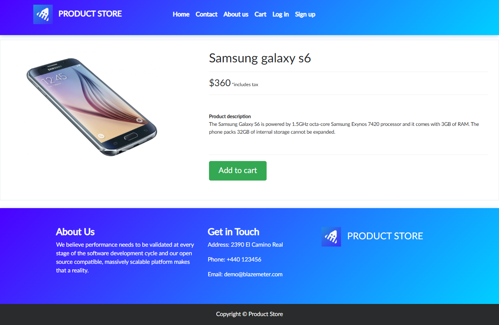

</details>

<details>
<summary><strong>📸 Test 5 · Locators encadenados</strong></summary>

<br>

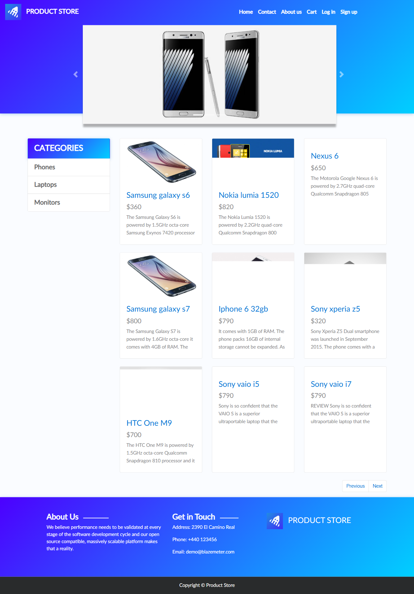

</details>

<details>
<summary><strong>📸 Test 6 · Negación de elementos</strong></summary>

<br>

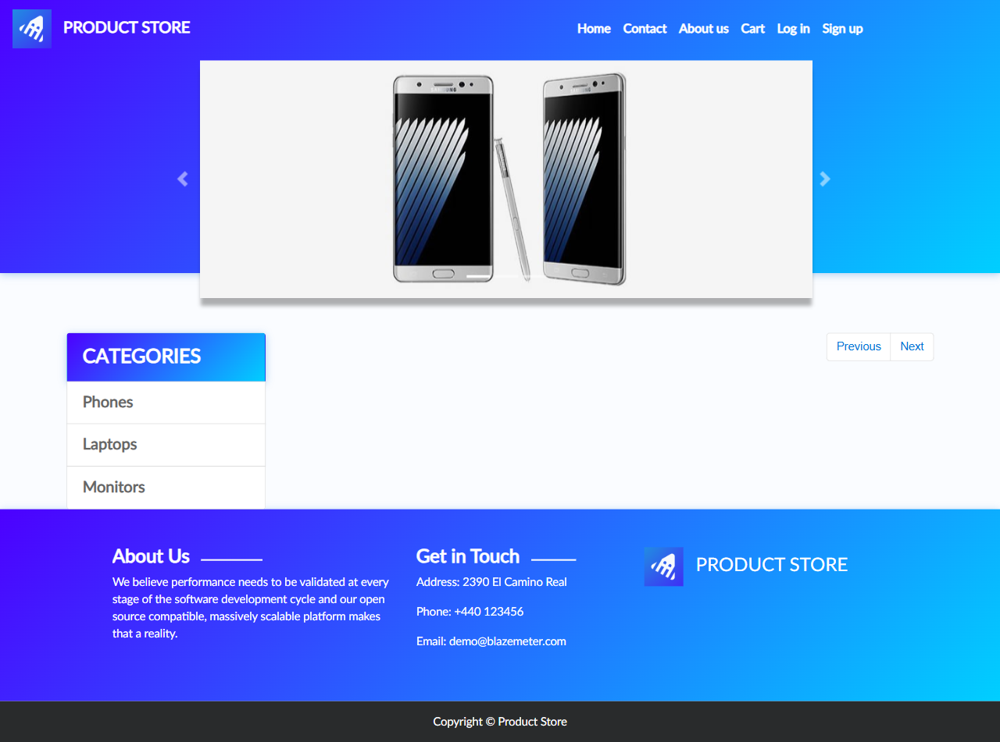

</details>

<details>
<summary><strong>📸 Test 7 · Reto 1 - Place Order con getByRole()</strong></summary>

<br>

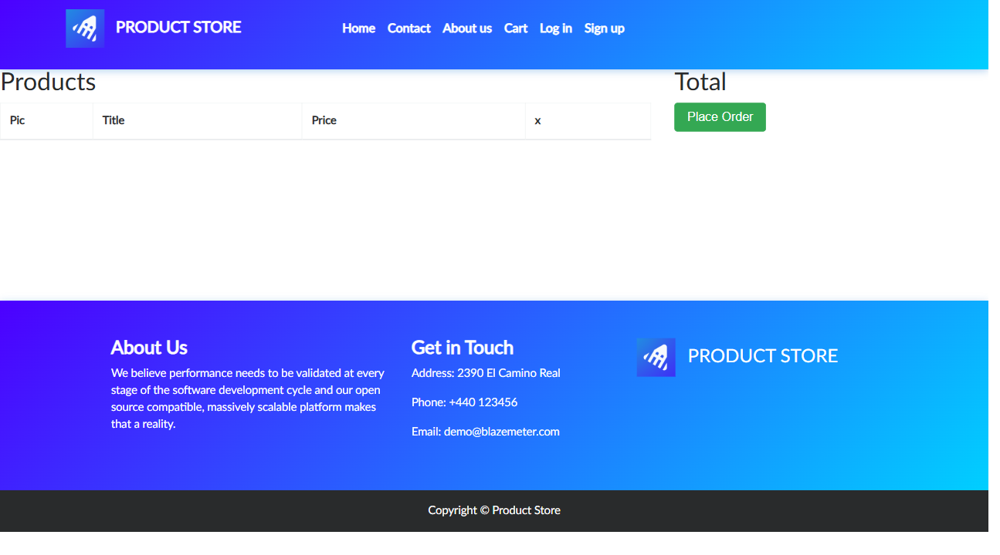

</details>

<details>
<summary><strong>📸 Test 8 · Reto 2 - filter()</strong></summary>

<br>


</details>

<details>
<summary><strong>📸 Test 9 · Reto 3 - atributo parcial</strong></summary>

<br>


</details>

<details>
<summary><strong>✅ Resultado general · 9 pruebas aprobadas</strong></summary>

<br>

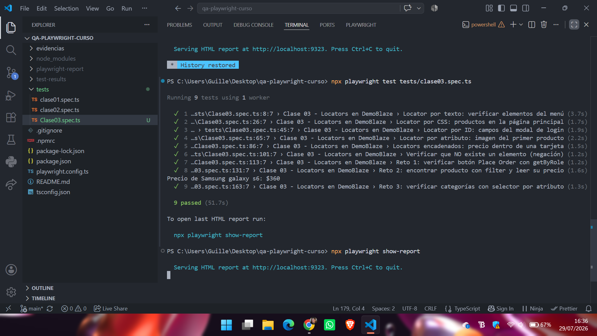

</details>

<details>
<summary><strong>📊 Reporte HTML de Playwright</strong></summary>

<br>

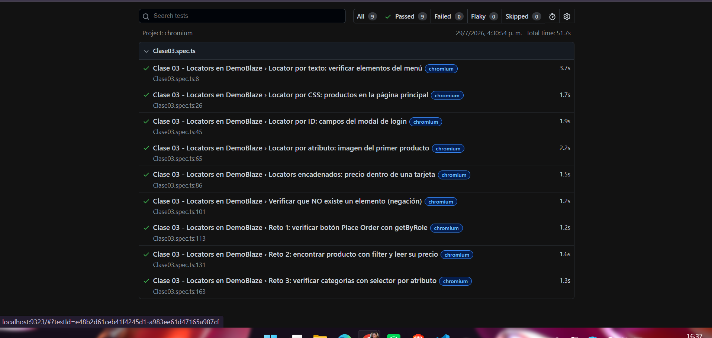

</details>

---

## Laboratorio 04 · Actions y flujo funcional en Playwright

> Objetivo: validar flujos funcionales reales de usuario con registro, login, carrito y formularios interactivos.

### Desarrollo del laboratorio

Este laboratorio integró acciones de usuario reales sobre la aplicación, incluyendo registro, autenticación, navegación al carrito y el uso de formularios interactivos para validar comportamientos funcionales completos.

### Pruebas implementadas

| # | Prueba | Estado |
|---|---|---|
| 1 | Registrar un nuevo usuario | ✅ |
| 2 | Login con usuario registrado | ✅ |
| 3 | Flujo login → carrito | ✅ |
| 4 | Login con credenciales incorrectas | ✅ |
| 5 | Reto 1: formulario Place Order | ✅ |
| 6 | Reto 2: cerrar modal con Close y .last() | ✅ |
| 7 | Reto 3: clear() y inputValue() | ✅ |

### Ejecutar laboratorio

```bash
npx playwright test tests/clase04.spec.ts
```

### Evidencias

<details>
<summary><strong>📸 Test 1 · Registrar un nuevo usuario</strong></summary>

<br>

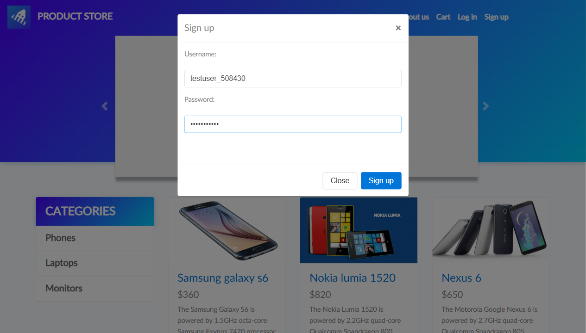

</details>

<details>
<summary><strong>📸 Test 2 · Login con usuario registrado</strong></summary>

<br>


</details>

<details>
<summary><strong>📸 Test 3 · Login → agregar producto → verificar carrito</strong></summary>

<br>

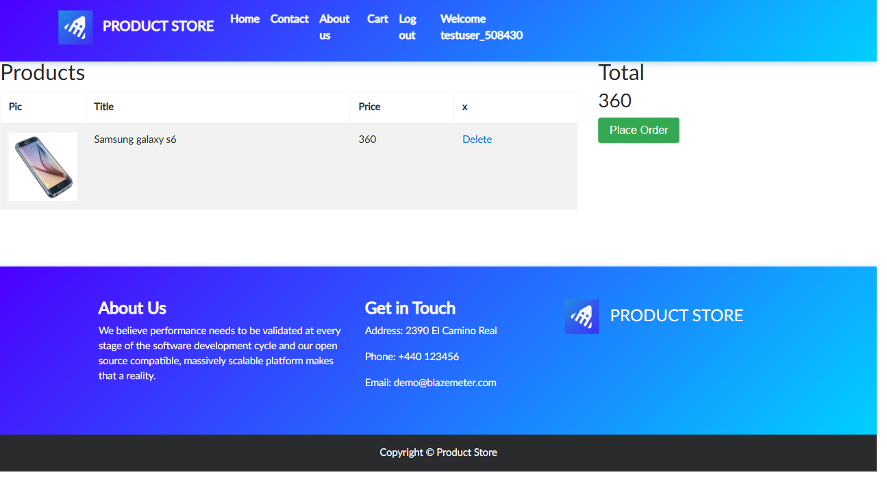

</details>

<details>
<summary><strong>📸 Test 4 · Login con credenciales incorrectas</strong></summary>

<br>


</details>

<details>
<summary><strong>📸 Test 5 · Reto 1 - formulario Place Order con fill()</strong></summary>

<br>

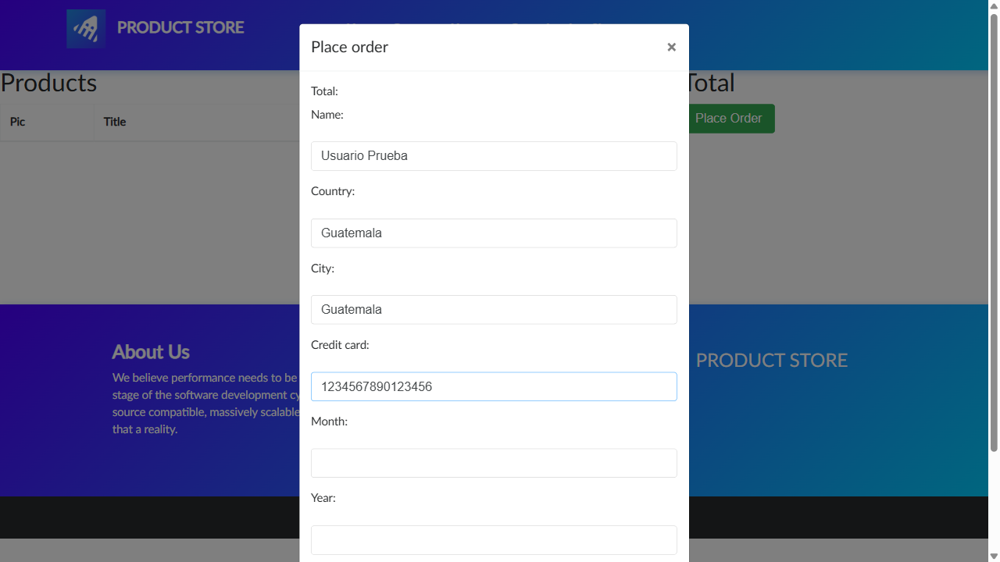

</details>

<details>
<summary><strong>📸 Test 6 · Reto 2 - cerrar modal con Close y .last()</strong></summary>

<br>

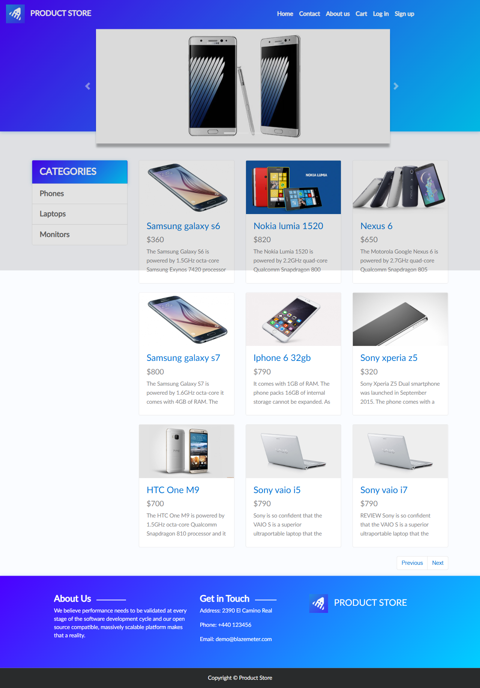

</details>

<details>
<summary><strong>📸 Test 7 · Reto 3 - clear() + inputValue()</strong></summary>

<br>

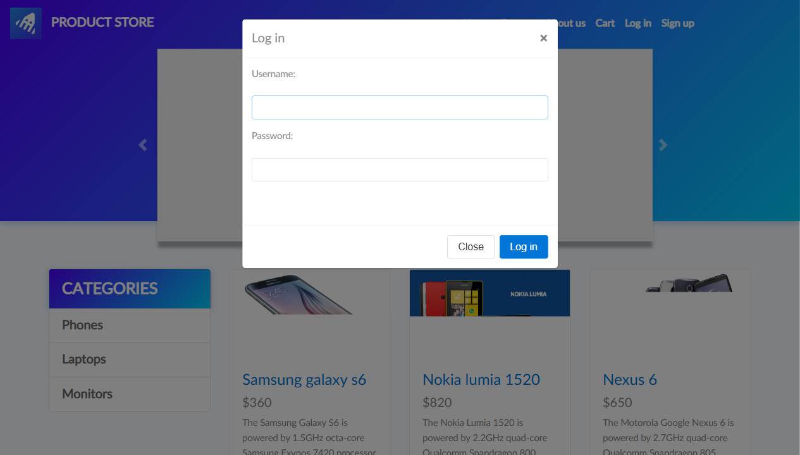

</details>

<details>
<summary><strong>✅ Resultado general · 7 pruebas aprobadas</strong></summary>

<br>

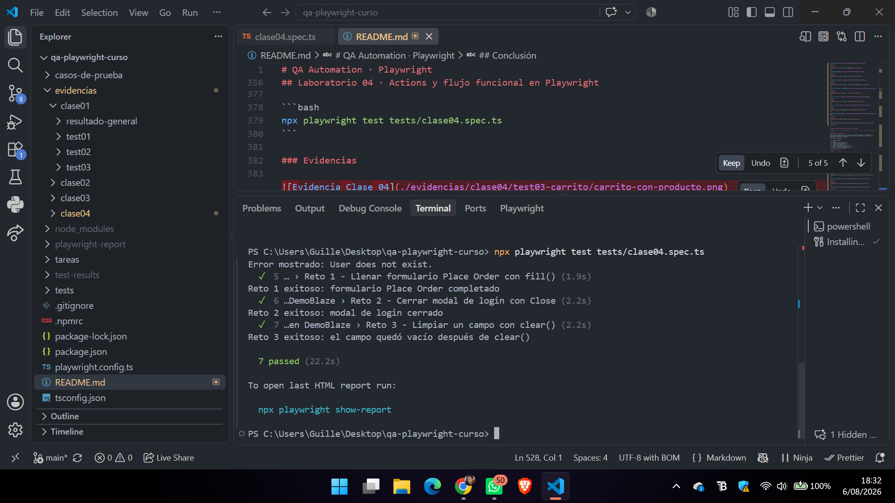

</details>

<details>
<summary><strong>📊 Reporte HTML de Playwright · Clase 04</strong></summary>

<br>

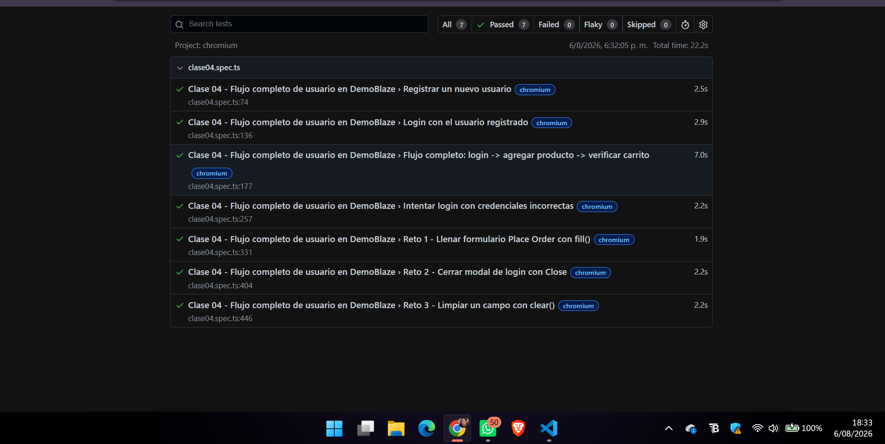

</details>

---

## Laboratorio 06 · Page Object Model (POM) en Sauce Demo

> Objetivo: implementar el patrón Page Object Model (POM) en Playwright para organizar las pruebas de forma mantenible y escalable, extendiendo la automatización a nuevos flujos de Sauce Demo.

### Desarrollo del laboratorio

En este laboratorio se reorganizaron las pruebas automatizadas mediante el patrón Page Object Model (POM), separando los selectores y las acciones de cada página de la lógica principal de los tests.

Se implementaron los Page Objects base `LoginPage`, `InventoryPage` y `CartPage`. Como parte de los retos de la Clase 06 se agregaron `CheckoutPage` y `MenuPage`, además del método `removeProductByName()` dentro de `InventoryPage`.

Con esta estructura se automatizaron flujos de autenticación, inventario, carrito, ordenamiento de productos, checkout completo, cierre de sesión y eliminación de productos.

### Pruebas implementadas

| # | Prueba | Estado |
|---|---|---|
| 1 | Login exitoso con POM | ✅ |
| 2 | Login fallido con POM | ✅ |
| 3 | Agregar 2 productos y verificar carrito | ✅ |
| 4 | Verificar que el inventario tiene 6 productos | ✅ |
| 5 | Ordenar productos de mayor a menor precio | ✅ |
| 6 | Reto 1: completar una compra de principio a fin | ✅ |
| 7 | Reto 2: cerrar sesión desde el menú hamburguesa | ✅ |
| 8 | Reto 3: quitar producto y verificar que el badge desaparece al llegar a 0 | ✅ |

### Page Objects implementados

```text
pages/
├── LoginPage.ts
├── InventoryPage.ts
├── CartPage.ts
├── CheckoutPage.ts
└── MenuPage.ts
```

### Ejecutar laboratorio

```bash
npx playwright test tests/clase06.spec.ts
```

Para visualizar la ejecución en el navegador:

```bash
npx playwright test tests/clase06.spec.ts --headed
```

### Evidencias

<details>
<summary><strong>📸 Test 1 · Login exitoso con POM</strong></summary>

<br>


</details>

<details>
<summary><strong>📸 Test 2 · Login fallido con POM</strong></summary>

<br>

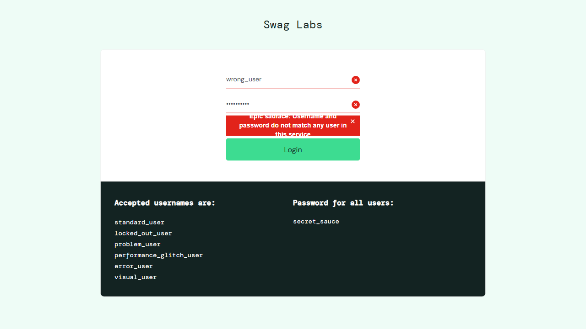

</details>

<details>
<summary><strong>📸 Test 3 · Agregar 2 productos y verificar carrito</strong></summary>

<br>

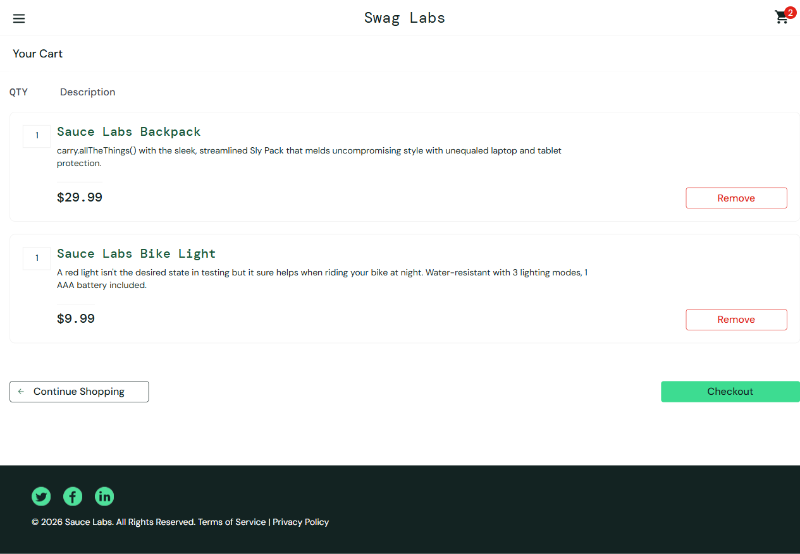

</details>

<details>
<summary><strong>📸 Test 4 · Inventario con 6 productos</strong></summary>

<br>

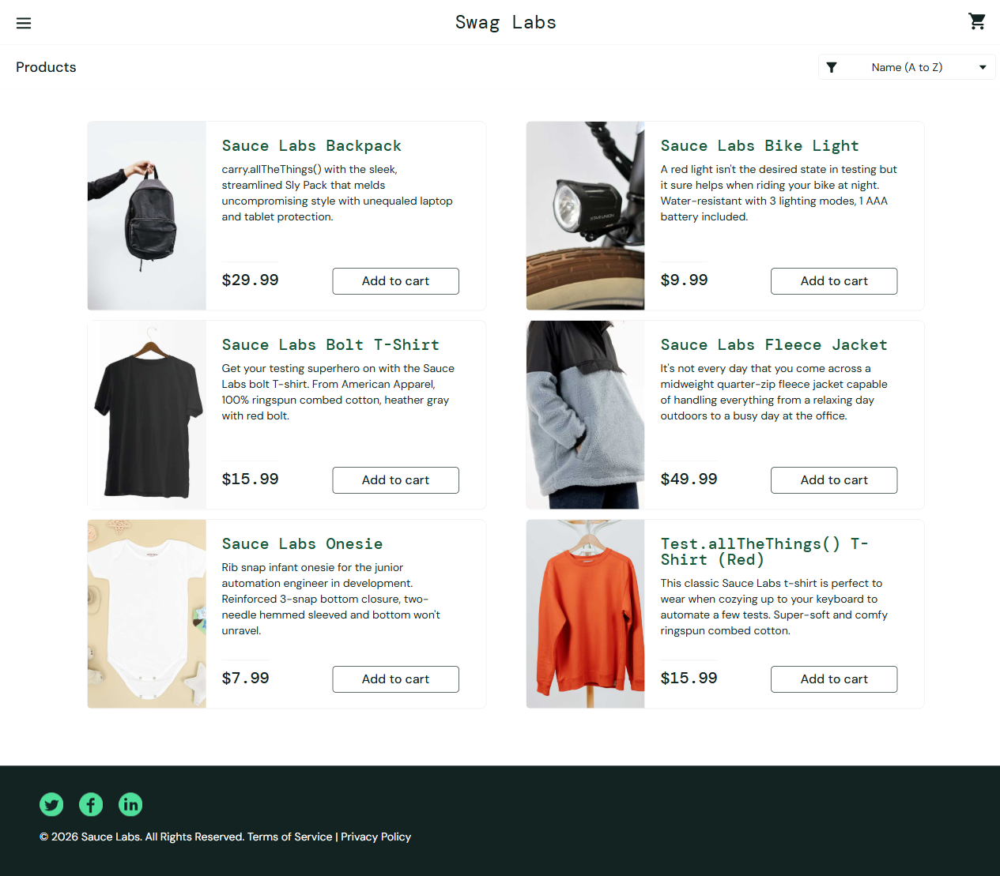

</details>

<details>
<summary><strong>📸 Test 5 · Ordenar productos de mayor a menor precio</strong></summary>

<br>

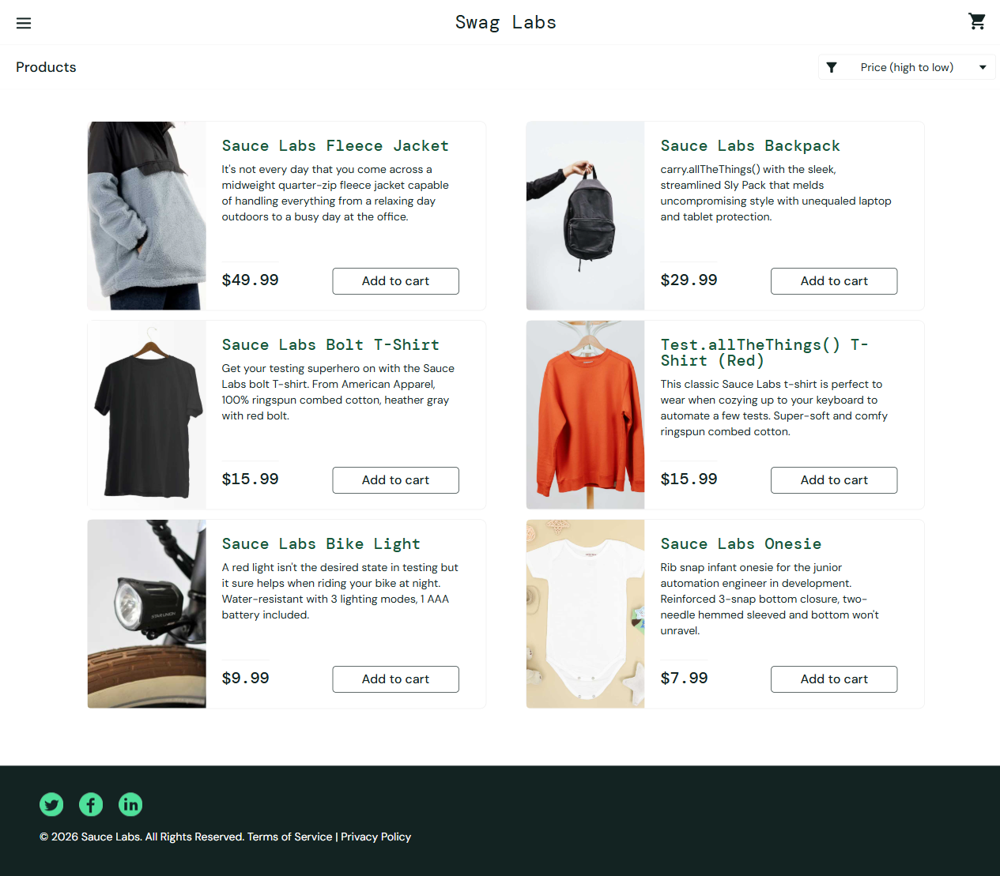

</details>

<details>
<summary><strong>📸 Test 6 · Reto 1 - Checkout completo</strong></summary>

<br>

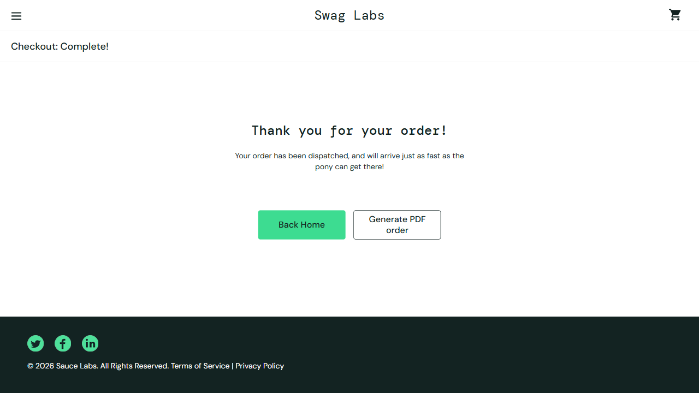

</details>

<details>
<summary><strong>📸 Test 7 · Reto 2 - Logout desde menú hamburguesa</strong></summary>

<br>

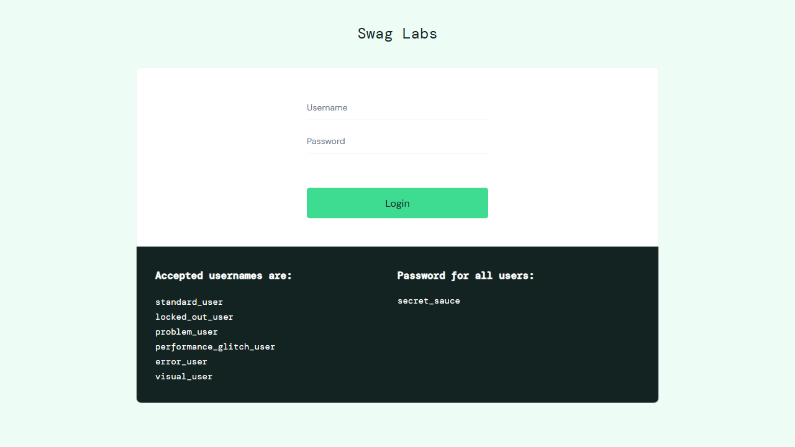

</details>

<details>
<summary><strong>📸 Test 8 · Reto 3 - Eliminar producto y verificar badge</strong></summary>

<br>

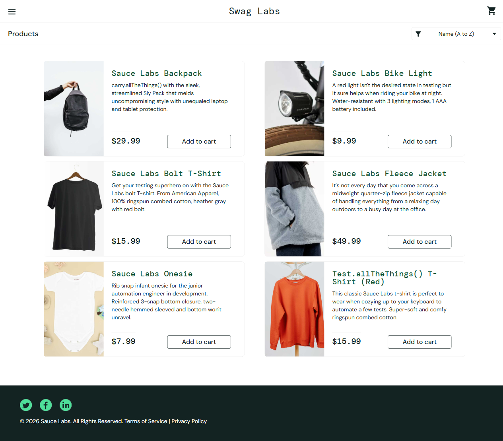

</details>

<details>
<summary><strong>✅ Resultado general · 8 pruebas aprobadas</strong></summary>

<br>

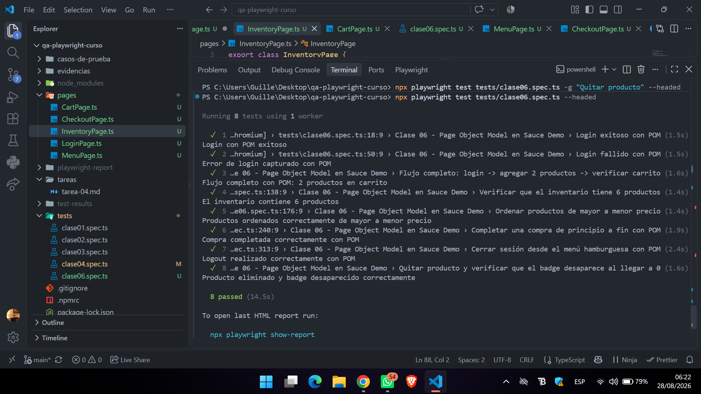

</details>

<details>
<summary><strong>📊 Reporte HTML de Playwright · Clase 06</strong></summary>

<br>

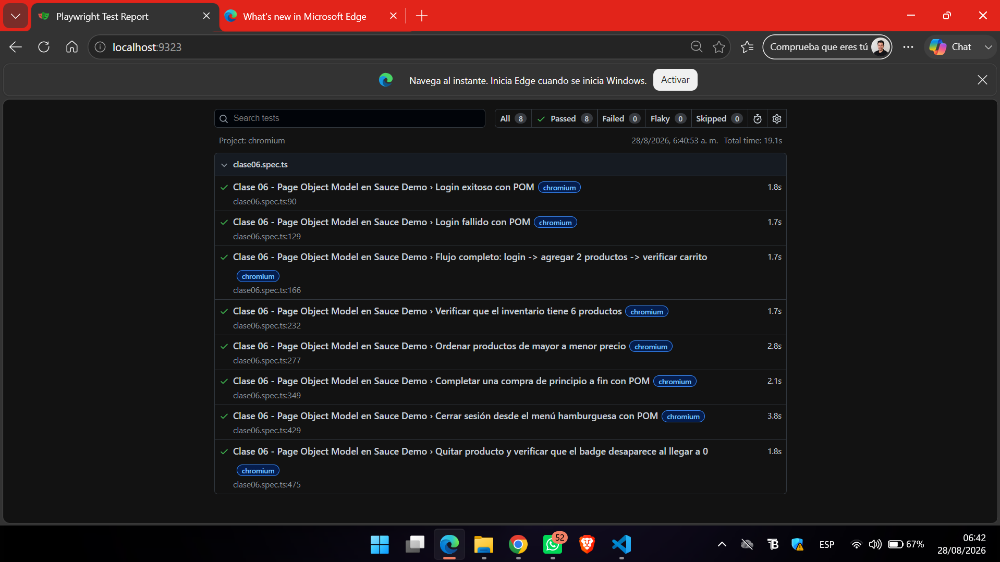

</details>

---

## Laboratorio 07 · Roles QA + Error, Defecto y Fallo + Evidencias avanzadas

> Objetivo: distinguir error, defecto y fallo; comprender los atributos de calidad ISO/IEC 25010; y generar evidencia profesional de pruebas con screenshots, videos y trazas (traces).

### Conceptos aplicados

| Concepto | Aplicación en este laboratorio |
|---|---|
| **Error** | Se introdujo deliberadamente una aserción incorrecta (`toHaveText('2')`) para simular la causa raíz. |
| **Defecto** | La línea de código quedó en el test, incorrecta pero sin haberse ejecutado todavía. |
| **Fallo** | Al ejecutar el test, la aserción falla y Playwright captura la evidencia automáticamente. |
| **ISO/IEC 25010** | Los tests cubren principalmente *Adecuación funcional*, y apoyan *Usabilidad* y *Fiabilidad* mediante evidencia reproducible. |

El ciclo completo de este razonamiento —y su evidencia— está documentado en **[reportes/DR-001.md](#reporte-de-defecto--dr-001)**.

### Desarrollo del laboratorio

Reutilizando los Page Objects `LoginPage` e `InventoryPage` de la Clase 06, se construyeron 4 tests en `tests/clase07.spec.ts` enfocados en documentar visualmente cada flujo: capturas antes/después del login, el recorrido completo de compra, el momento exacto de un defecto esperado (usuario bloqueado) y una comparación de estados antes/después de una acción.

Como tarea de la clase, se agregaron 3 tests reto en `tests/tarea07.spec.ts` con técnicas de evidencia **no vistas en el laboratorio**: pasos nombrados con `test.step()`, adjuntos de datos con `testInfo.attach()`, y comparación visual contra una imagen baseline con `toHaveScreenshot()`.

Adicionalmente, se activó la configuración completa de evidencias en `playwright.config.ts` (`screenshot: 'on'`, `video: 'on'`, `trace: 'on'`) y el reporter `html`, necesario para inspeccionar todo con `npx playwright show-report`.

### Pruebas implementadas — `tests/clase07.spec.ts`

| # | Prueba | Evidencia generada | Estado |
|---|---|---|---|
| 1 | Login exitoso - evidencia completa | Screenshot antes y después del login | ✅ |
| 2 | Documentar el flujo de compra completo | Screenshots de inventario, producto agregado y carrito | ✅ |
| 3 | Capturar el momento exacto de un defecto esperado | Screenshot del elemento de error (usuario bloqueado) | ✅ |
| 4 | Comparar estados antes y después de una acción | Screenshots del badge del carrito antes/después | ✅ |

### Tests reto — `tests/tarea07.spec.ts` (evidencias avanzadas)

| # | Reto | Técnica | Qué demuestra | Estado |
|---|---|---|---|---|
| 1 | Login estructurado en pasos | `test.step()` | Cada paso (navegar, login, verificar) aparece por separado en el reporte y el trace | ✅ |
| 2 | Adjuntar datos capturados | `testInfo.attach()` | Adjunta un `.txt` con cantidad de productos, URL y fecha directo al reporte HTML | ✅ |
| 3 | Comparación visual del inventario | `toHaveScreenshot()` | Compara pixel a pixel contra un baseline versionado en el repo | ✅ |

> El baseline del Reto 3 vive en [`tests/tarea07.spec.ts-snapshots/inventario-baseline-chromium-win32.png`](./tests/tarea07.spec.ts-snapshots/inventario-baseline-chromium-win32.png) y debe comitearse junto con el test — es la referencia contra la que se compararán las corridas futuras.

### Ejecutar laboratorio

```bash
# Tests del laboratorio (Clase 07)
npx playwright test tests/clase07.spec.ts

# Tests reto (Tarea 07)
npx playwright test tests/tarea07.spec.ts

# Primera vez que corres el Reto 3 en otra máquina: genera el baseline
npx playwright test tests/tarea07.spec.ts --update-snapshots
```

### Analizar el reporte y el Trace Viewer

```bash
npx playwright show-report
```

Desde el reporte HTML se puede: ver el estado (pass/fail) de cada test, revisar los screenshots automáticos, reproducir el video de la ejecución y abrir el **Trace Viewer** (enlace "Trace" en cada test) para ver, paso a paso, el timeline de acciones, screenshots intermedios, requests de red y logs de consola — la evidencia más completa que genera Playwright.

### Evidencias

<details>
<summary><strong>📸 Test 1 · Login antes / después</strong></summary>

<br>


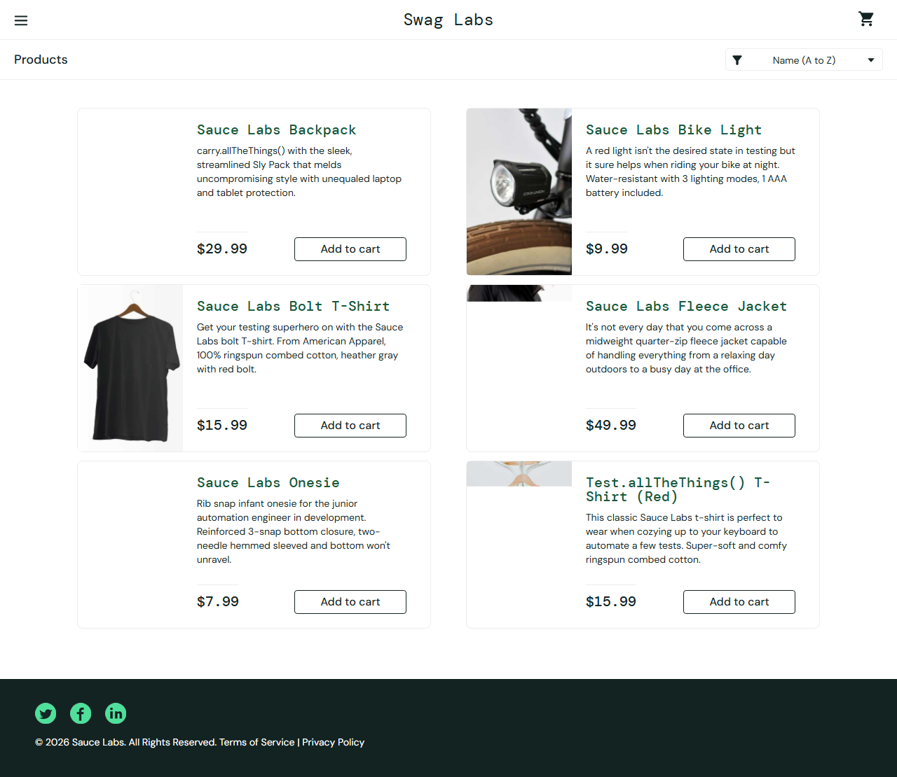

</details>

<details>
<summary><strong>📸 Test 2 · Flujo de compra completo</strong></summary>

<br>


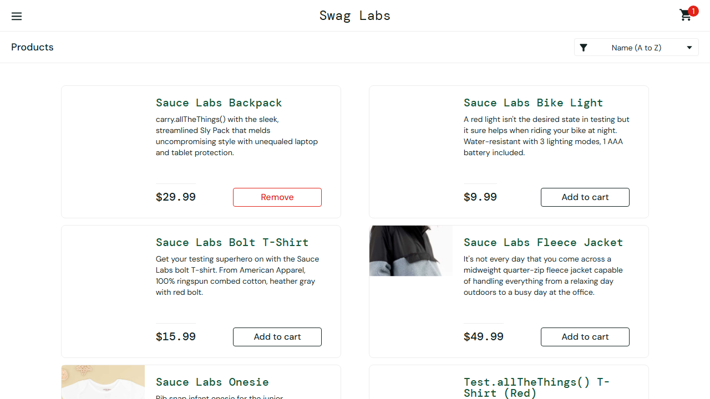

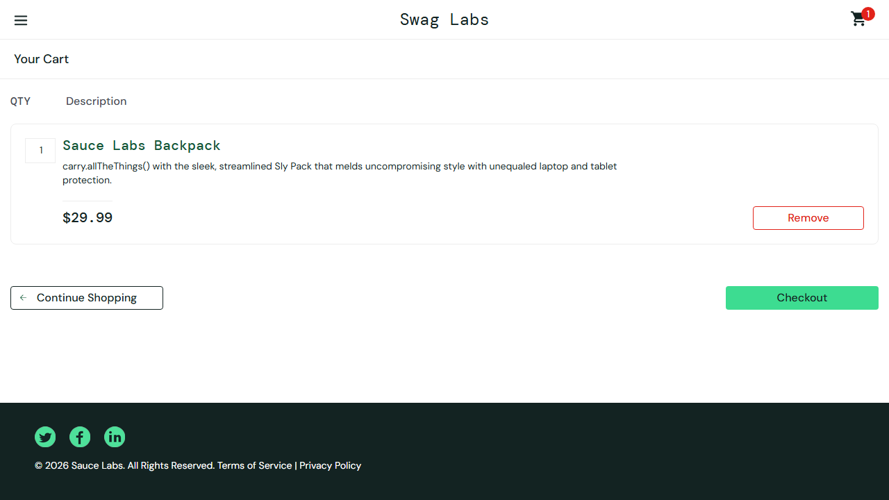

</details>

<details>
<summary><strong>📸 Test 3 · Defecto esperado (usuario bloqueado)</strong></summary>

<br>


</details>

<details>
<summary><strong>📸 Test 4 · Estado antes / después del badge</strong></summary>

<br>


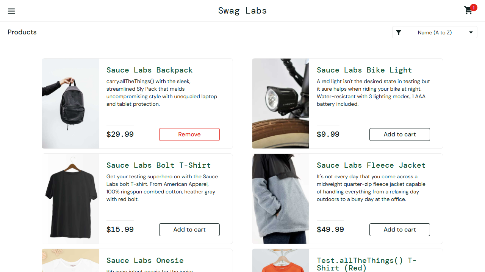

</details>

<details>
<summary><strong>🖼️ Reto 3 · Baseline visual del inventario (toHaveScreenshot)</strong></summary>

<br>


</details>

---

## Reporte de defecto · DR-001

Como parte del laboratorio se simuló un defecto real siguiendo el ciclo completo de detección → evidencia → documentación: se forzó un valor incorrecto en una aserción, se ejecutó la suite, se capturó la evidencia del fallo (screenshot, video y trace) y finalmente se revirtió el cambio, confirmando que era un defecto simulado y no un bug real del sitio.

| Campo | Valor |
|---|---|
| **Título** | El badge del carrito no incrementa a "2" tras agregar un solo producto |
| **Severidad / Prioridad** | Media / Media |
| **Resultado esperado** | `"2"` (valor forzado a propósito en el test) |
| **Resultado obtenido** | `"1"` (comportamiento real y correcto del sitio) |
| **Evidencia** | [`evidencias/clase07/DR-001-fallo-badge.png`](./evidencias/clase07/DR-001-fallo-badge.png) + video y trace generados automáticamente |
| **Estado** | Cerrado — cambio revertido, test vuelve a pasar |

📄 Reporte completo: **[reportes/DR-001.md](./reportes/DR-001.md)**

<details>
<summary><strong>📸 Evidencia del fallo simulado</strong></summary>

<br>


</details>

---

## Laboratorio 08 · Hooks y suites avanzadas

> Objetivo: aplicar `beforeEach`/`afterEach` para automatizar el login y la evidencia de fallos, ejecutar suites en modo `parallel`, y validar comportamientos distintos según el tipo de usuario de SauceDemo.

### Desarrollo del laboratorio

Se creó `helpers/auth.ts` con la función `loginAs()` para centralizar el login y reutilizarlo en toda la suite. En `tests/clase08.spec.ts` los tests se organizaron en dos `describe` en modo `parallel`: uno con `beforeEach` (login automático antes de cada test) y `afterEach` (captura de screenshot solo si el test falla), y otro que compara el comportamiento de `standard_user` frente a `performance_glitch_user` (usuario con ~5s de delay artificial en el login).

Como tarea de la clase, se agregaron 3 tests reto en `tests/tarea08.spec.ts` con técnicas de hooks/suites **no vistas en el laboratorio**: una suite `serial` con una página compartida creada en `beforeAll` (el modo `serial` por sí solo no comparte la `page` entre tests), `test.slow()` para triplicar el timeout de un test lento en vez de depender del margen del timeout global, y `test.skip()` evaluado dinámicamente en tiempo de ejecución, documentando la razón del skip.

### Pruebas implementadas — `tests/clase08.spec.ts`

| # | Prueba | Estado |
|---|---|---|
| 1 | El inventario muestra 6 productos | ✅ |
| 2 | Todos los productos tienen precio visible | ✅ |
| 3 | Todos los productos tienen imagen visible | ✅ |
| 4 | El menú de hamburguesa funciona | ✅ |
| 5 | Logout funciona correctamente | ✅ |
| 6 | Usuario estándar puede completar el checkout | ✅ |
| 7 | Usuario de rendimiento degradado experimenta lentitud | ✅ |

### Tests reto — `tests/tarea08.spec.ts` (hooks y suites avanzados)

| # | Reto | Técnica | Qué demuestra | Estado |
|---|---|---|---|---|
| 1 | Suite serial con página compartida | `test.describe.configure({ mode: 'serial' })` + `page` creada en `beforeAll` | Los 3 tests reutilizan la misma sesión/estado (login → agregar producto → verificar carrito) en vez de repetir el login en cada uno | ✅ |
| 2 | `test.slow()` | `test.slow()` | Triplica el timeout del test del usuario con lentitud artificial (30 000 ms → 90 000 ms) en vez de depender del margen del timeout global | ✅ |
| 3 | `test.skip()` dinámico | `test.skip(condición, razón)` | Evalúa en tiempo de ejecución si un producto existe en el catálogo y omite el test documentando la razón, en vez de fallar | ⏭️ Omitido a propósito |

### Ejecutar laboratorio

```bash
# Tests del laboratorio (Clase 08)
npx playwright test tests/clase08.spec.ts

# Tests reto (Tarea 08)
npx playwright test tests/tarea08.spec.ts
```

### Evidencias

<details>
<summary><strong>📸 Test 1 · Inventario con 6 productos</strong></summary>

<br>

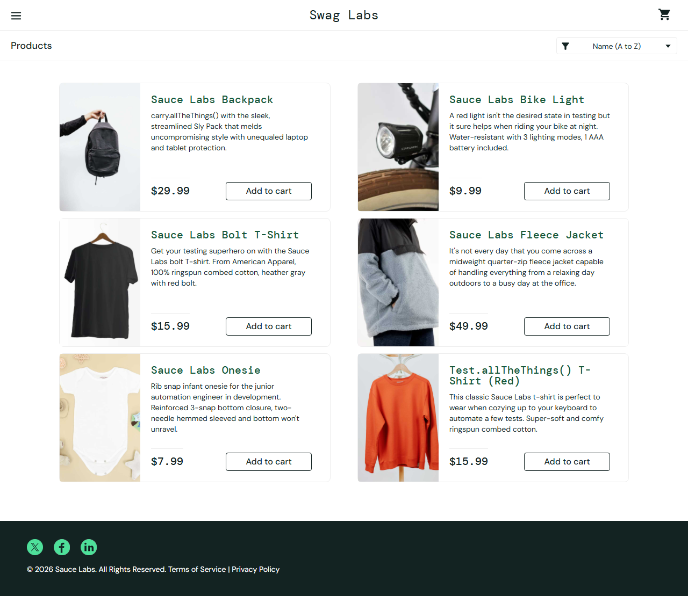

</details>

<details>
<summary><strong>📸 Test 2 · Precios en formato correcto</strong></summary>

<br>


</details>

<details>
<summary><strong>📸 Test 3 · Imágenes de productos visibles</strong></summary>

<br>


</details>

<details>
<summary><strong>📸 Test 4 · Menú de hamburguesa abierto</strong></summary>

<br>

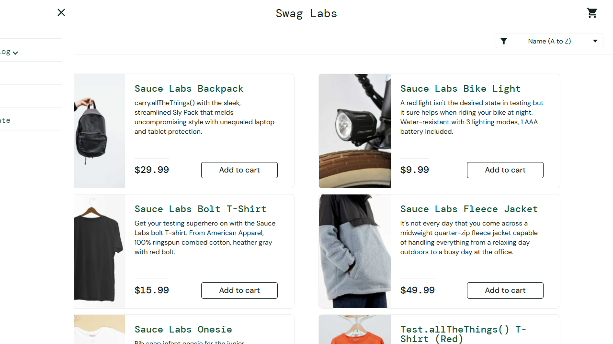

</details>

<details>
<summary><strong>📸 Test 5 · Logout exitoso</strong></summary>

<br>

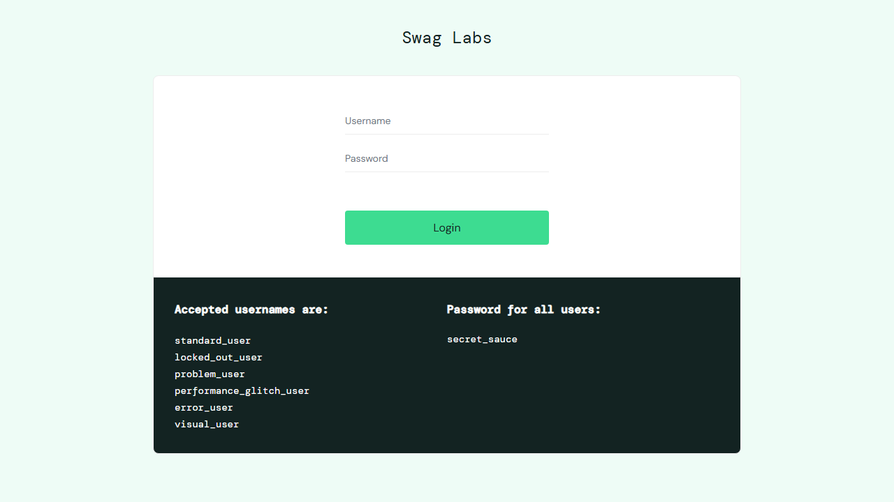

</details>

<details>
<summary><strong>📸 Test 6 · Checkout con usuario estándar</strong></summary>

<br>

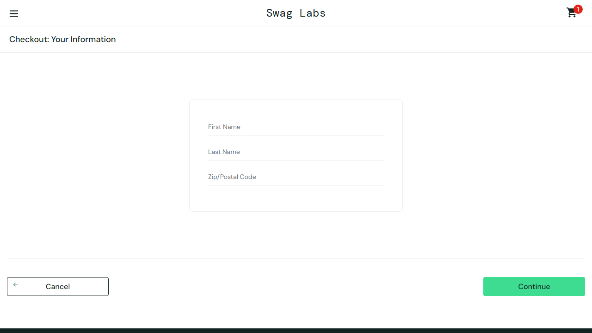

</details>

<details>
<summary><strong>📸 Test 7 · Inventario con usuario de rendimiento degradado</strong></summary>

<br>

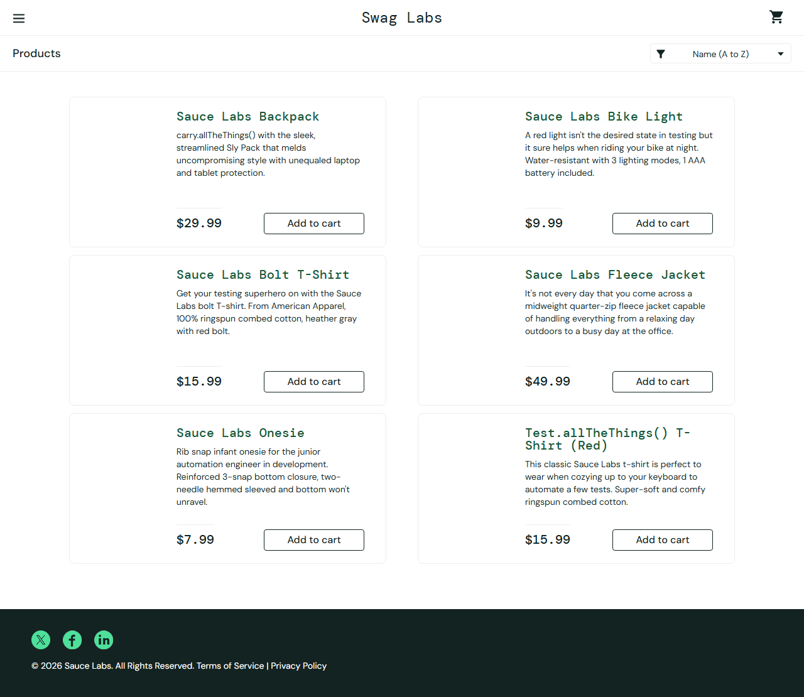

</details>

<details>
<summary><strong>📸 Reto 1 · Carrito con estado compartido (suite serial)</strong></summary>

<br>


</details>

<details>
<summary><strong>📸 Reto 2 · Usuario con lentitud artificial (test.slow())</strong></summary>

<br>

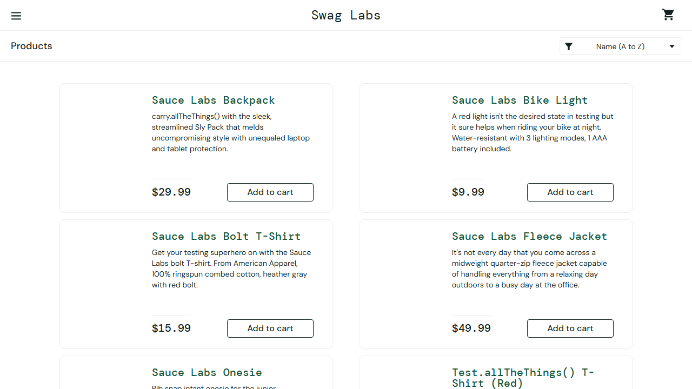

</details>

<details>
<summary><strong>📸 Reto 3 · Inventario evaluado antes del skip dinámico</strong></summary>

<br>


</details>

<details>
<summary><strong>✅ Resultado general · 11 pruebas aprobadas, 1 omitida a propósito</strong></summary>

<br>

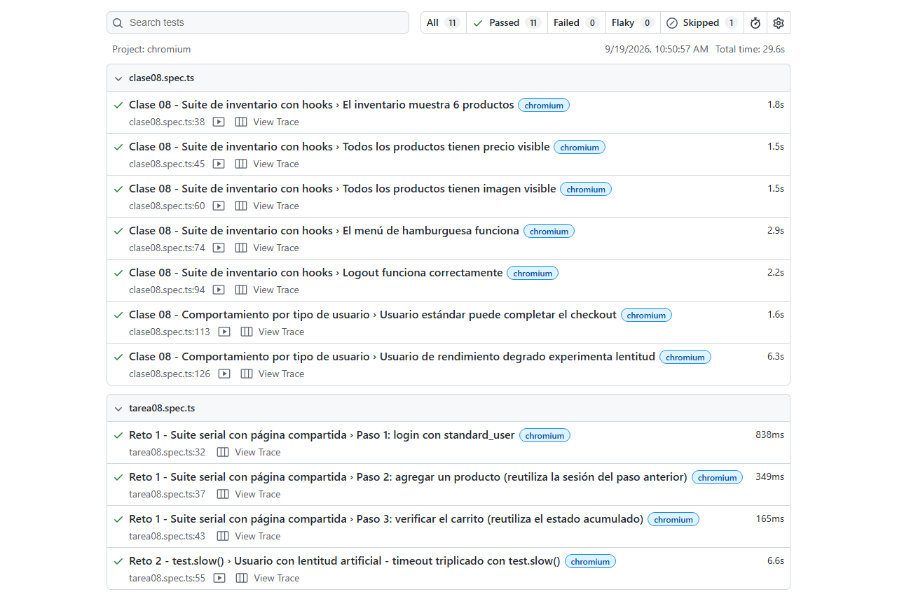

</details>

---

## Laboratorio 09 · Fixtures y tests parametrizados

> Objetivo: compartir configuración y estado entre tests mediante fixtures de Playwright (`base.extend`), y cubrir varios escenarios con un solo bloque de código usando datos de prueba y tests parametrizados.

### Desarrollo del laboratorio

Se creó `fixtures/index.ts` con tres fixtures que reutilizan los Page Objects existentes: `loginPage` (página de login lista para usar), `inventoryPage` (ya autenticada como `standard_user`) y `cartPage` (con 1 producto agregado y el carrito abierto). En `cartPage` se espera explícitamente a que el ítem sea visible antes de entregar el fixture, porque `getItemCount()` usa `.count()`, que **no** espera automáticamente (a diferencia de `expect()`).

En `tests/clase09.spec.ts` se consumen los fixtures y se parametrizan dos escenarios con un `for` sobre arrays de datos: el login con tres usuarios representativos (válido, bloqueado y campos vacíos — no solo el camino feliz) y el agregado al carrito de tres productos distintos.

Como tarea de la clase, `tests/tarea09.spec.ts` incorpora 3 retos con técnicas de fixtures **no vistas en el laboratorio**: teardown real (código posterior a `use()`), fixture con alcance `worker` y `test.use({ viewport })` combinado con parametrización.

> Nivel en la pirámide de automatización: todos los tests del curso son **E2E** (punta de la pirámide); no se escriben pruebas unitarias ni de integración porque se prueban aplicaciones ya desplegadas.

### Pruebas implementadas — `tests/clase09.spec.ts`

| # | Prueba | Técnica | Estado |
|---|---|---|---|
| 1 | Usando fixture de login: verificar inventario | Fixture `inventoryPage` | ✅ |
| 2 | Usando fixture de carrito: verificar que hay 1 item | Fixture `cartPage` | ✅ |
| 3 | Usando fixture de loginPage: login manual en el test | Fixture `loginPage` | ✅ |
| 4 | Login: usuario estándar puede ingresar | Parametrizado (`usuariosDeLogin`) | ✅ |
| 5 | Login: usuario bloqueado no puede ingresar | Parametrizado (`usuariosDeLogin`) | ✅ |
| 6 | Login: campos vacíos muestran error | Parametrizado (`usuariosDeLogin`) | ✅ |
| 7 | Agregar "Sauce Labs Backpack" al carrito | Parametrizado (`productosAVerificar`) | ✅ |
| 8 | Agregar "Sauce Labs Bike Light" al carrito | Parametrizado (`productosAVerificar`) | ✅ |
| 9 | Agregar "Sauce Labs Bolt T-Shirt" al carrito | Parametrizado (`productosAVerificar`) | ✅ |

### Tests reto — `tests/tarea09.spec.ts` (fixtures avanzados)

| # | Reto | Técnica | Qué demuestra | Estado |
|---|---|---|---|---|
| 1 | Fixture con teardown real | Código después de `use()` | El setup arranca un cronómetro y el teardown, que corre al terminar el test (verificado también cuando el test falla), imprime cuánto tardó | ✅ |
| 2 | Fixture de alcance worker | `[fn, { scope: 'worker' }]` + modo `serial` | El estado del fixture persiste entre tests del mismo worker: un contador sube de 1 a 2 | ✅ |
| 3 | `test.use()` + parametrización | `test.use({ viewport })` dentro de un `for` | El mismo test corre en viewport móvil (375×667) y de escritorio (1280×720) | ✅ (2 tests) |

### Reflexión y discusión (Paso 4)

1. **¿Cuántas líneas se ahorran con el loop?** Sin parametrización habría que escribir 6 bloques `test()` casi idénticos (3 de login y 3 de producto) de ~10 líneas cada uno; con los dos `for` quedan 2 bloques, por lo que se ahorran más de 30 líneas y los cambios futuros se hacen en un solo lugar.
2. **¿Qué pasa si se agrega un 4.º usuario a `usuariosDeLogin`?** El loop genera automáticamente un cuarto test, sin tocar el cuerpo del test.
3. **¿Cómo leer los datos desde un CSV externo?** Leyendo el archivo con `fs.readFileSync` y convirtiéndolo a un arreglo de objetos (por ejemplo con `csv-parse`) al inicio del spec, antes del `for`, ya que los tests se generan al cargar el archivo.

### Ejecutar laboratorio

```bash
# Tests del laboratorio (Clase 09) - reporter de lista
npx playwright test tests/clase09.spec.ts --reporter=list

# Tests reto (Tarea 09)
npx playwright test tests/tarea09.spec.ts

# Ambos, con 5 workers en paralelo
npx playwright test tests/clase09.spec.ts tests/tarea09.spec.ts --workers=5

# Reporte HTML
npx playwright show-report
```

### Evidencias

<details>
<summary><strong>📸 Test 1 · Fixture inventoryPage</strong></summary>

<br>


</details>

<details>
<summary><strong>📸 Test 2 · Fixture cartPage</strong></summary>

<br>


</details>

<details>
<summary><strong>📸 Test 3 · Fixture loginPage con login manual</strong></summary>

<br>

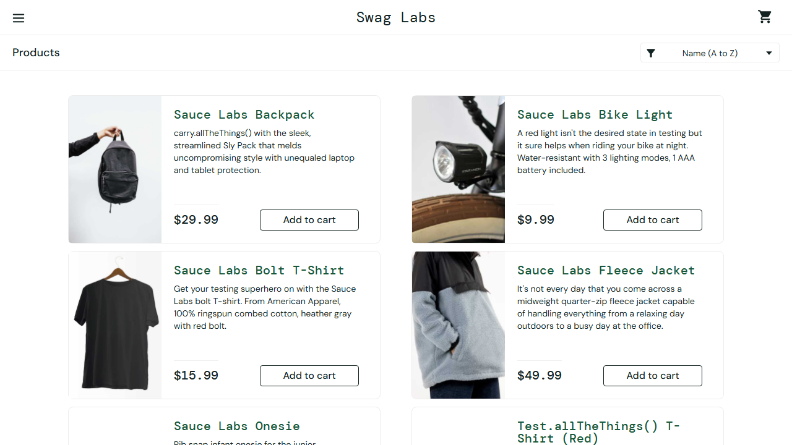

</details>

<details>
<summary><strong>📸 Tests 4-6 · Login parametrizado (estándar, bloqueado, campos vacíos)</strong></summary>

<br>


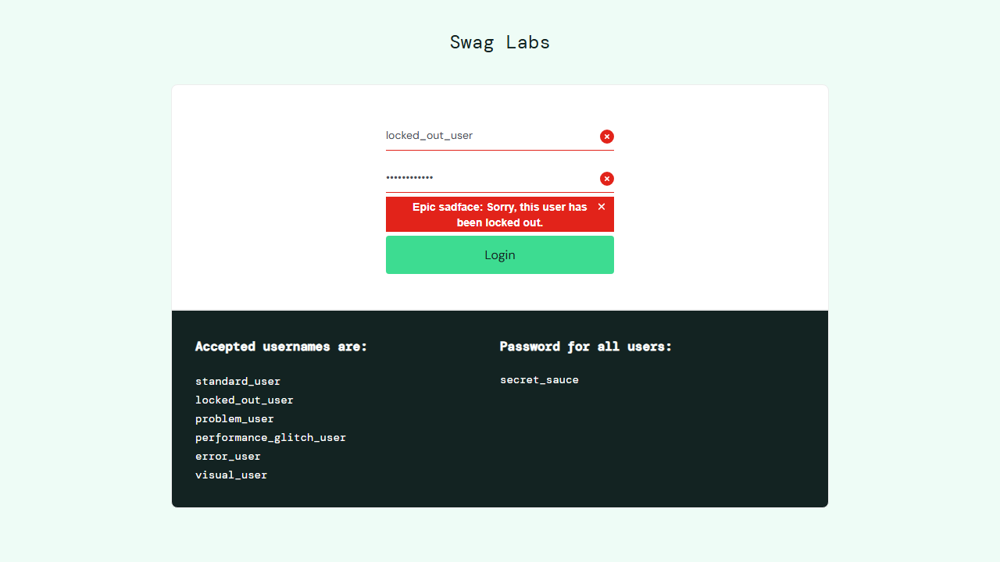

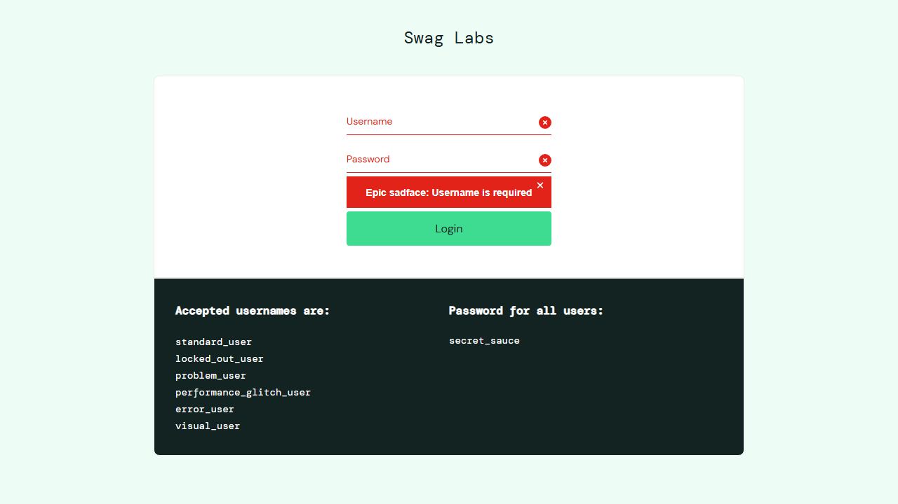

</details>

<details>
<summary><strong>📸 Tests 7-9 · Productos parametrizados en el carrito</strong></summary>

<br>


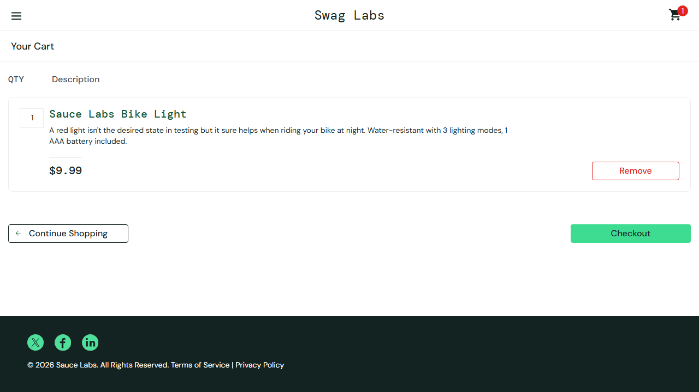

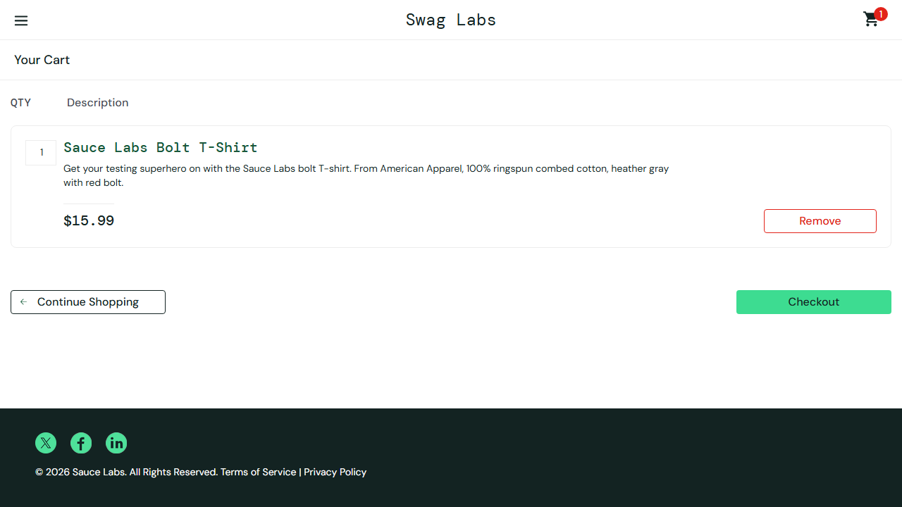

</details>

<details>
<summary><strong>📸 Reto 1 · Fixture con teardown</strong></summary>

<br>


</details>

<details>
<summary><strong>📸 Reto 3 · Viewport móvil y escritorio</strong></summary>

<br>

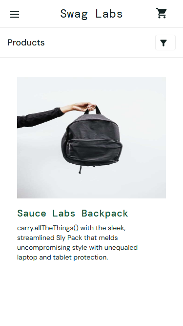

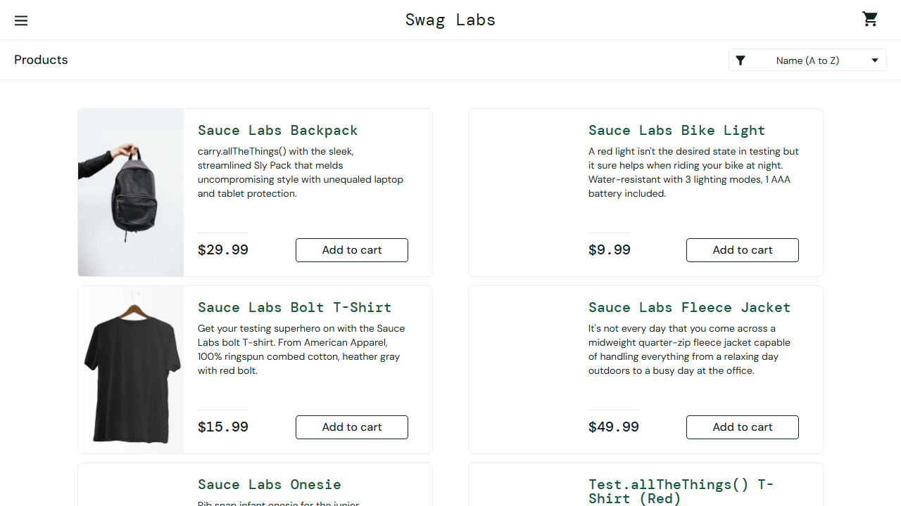

</details>

<details>
<summary><strong>✅ Resultado general · 14 pruebas aprobadas (9 del laboratorio + 5 de los retos)</strong></summary>

<br>

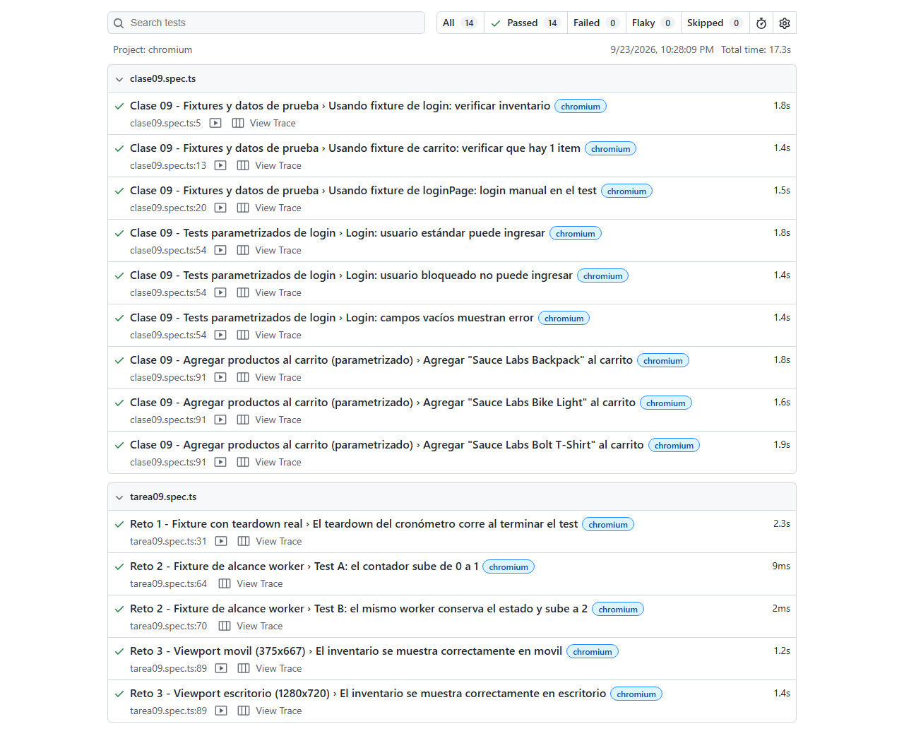

</details>

---

## Evidencias destacadas

La organización de las capturas se realizó de forma estructurada por clase y por prueba, con el propósito de conservar de manera ordenada las evidencias generadas durante la ejecución de cada laboratorio.

- [Evidencias Clase 01](./evidencias/clase01)
- [Evidencias Clase 02](./evidencias/clase02)
- [Evidencias Clase 03](./evidencias/clase03)
- [Evidencias Clase 04](./evidencias/clase04)
- [Evidencias Clase 06](./evidencias/clase06)
- [Evidencias Clase 07](./evidencias/clase07)
- [Evidencias Clase 08](./evidencias/clase08)
- [Evidencias Clase 09](./evidencias/clase09)
- [Baseline visual — Tarea 07](./tests/tarea07.spec.ts-snapshots)
- [Reportes de defectos](./reportes)

---

## Estructura del proyecto

```text
QA-PLAYWRIGHT-CURSO
├── casos-de-prueba/
│   └── TC-001.md
├── documentos/
│   └── sqa-plan-saucedemo.md
├── evidencias/
│   ├── clase01/
│   ├── clase02/
│   ├── clase03/
│   ├── clase04/
│   ├── clase06/
│   ├── clase07/
│   │   └── DR-001-fallo-badge.png
│   ├── clase08/
│   │   ├── test01 … test07/
│   │   ├── tarea08-reto1 … tarea08-reto3/
│   │   └── resultado-general/
│   └── clase09/
│       ├── test01 … test05/
│       ├── tarea09-reto1, tarea09-reto3/
│       └── resultado-general/
├── fixtures/
│   └── index.ts
├── helpers/
│   └── auth.ts
├── pages/
│   ├── LoginPage.ts
│   ├── InventoryPage.ts
│   ├── CartPage.ts
│   ├── CheckoutPage.ts
│   └── MenuPage.ts
├── reportes/
│   └── DR-001.md
├── tareas/
│   └── tarea-04.md
├── tests/
│   ├── clase01.spec.ts
│   ├── clase02.spec.ts
│   ├── clase03.spec.ts
│   ├── clase04.spec.ts
│   ├── clase06.spec.ts
│   ├── clase07.spec.ts
│   ├── clase08.spec.ts
│   ├── clase09.spec.ts
│   ├── tarea07.spec.ts
│   ├── tarea07.spec.ts-snapshots/
│   │   └── inventario-baseline-chromium-win32.png
│   ├── tarea08.spec.ts
│   └── tarea09.spec.ts
├── package.json
├── playwright.config.ts
├── README.md
└── tsconfig.json
```

---

## Ejecución

### Instalación

```bash
npm install
npx playwright install chromium
```

### Ejecutar todas las pruebas

```bash
npx playwright test
```

### Abrir reporte HTML

```bash
npx playwright show-report
```

---

## Documentación adicional

- [Caso de prueba TC-001](./casos-de-prueba/TC-001.md)
- [Tarea 04](./tareas/tarea-04.md)
- [Reporte de defecto DR-001](./reportes/DR-001.md)
- [SQA Plan mínimo — Sauce Demo](./documentos/sqa-plan-saucedemo.md)

---

## Conclusión

Este proyecto evidencia la aplicación práctica de pruebas automatizadas con Playwright en un entorno académico, fortaleciendo la trazabilidad, la documentación y la validación funcional de aplicaciones web reales como DemoBlaze y Sauce Demo.

A partir de la Clase 07, el proyecto suma una dimensión de **calidad profesional del proceso de pruebas**: evidencia completa y reproducible (screenshots, videos, trazas), técnicas avanzadas de reporte (`test.step()`, `testInfo.attach()`, `toHaveScreenshot()`) y documentación formal de defectos bajo la cadena causal Error → Defecto → Fallo — llevando el repositorio de "tests que pasan" a "tests que además comunican y documentan calidad".

La Clase 08 incorpora, además, control estructural de la ejecución con hooks (`beforeEach`/`afterEach`, `beforeAll`/`afterAll`), suites en modo `parallel` y `serial`, y ajustes dinámicos por test (`test.slow()`, `test.skip()` condicional) — junto con un SQA Plan mínimo que documenta propósito, alcance, herramientas y criterios de salida del proyecto.

La Clase 09 cierra el módulo con **reutilización y cobertura de datos**: fixtures propios (`base.extend`) que encapsulan el estado previo de cada test —incluyendo teardown y alcance `worker`— y tests parametrizados que multiplican los escenarios cubiertos (usuarios válidos, bloqueados, campos vacíos, distintos productos y viewports) sin duplicar código.
